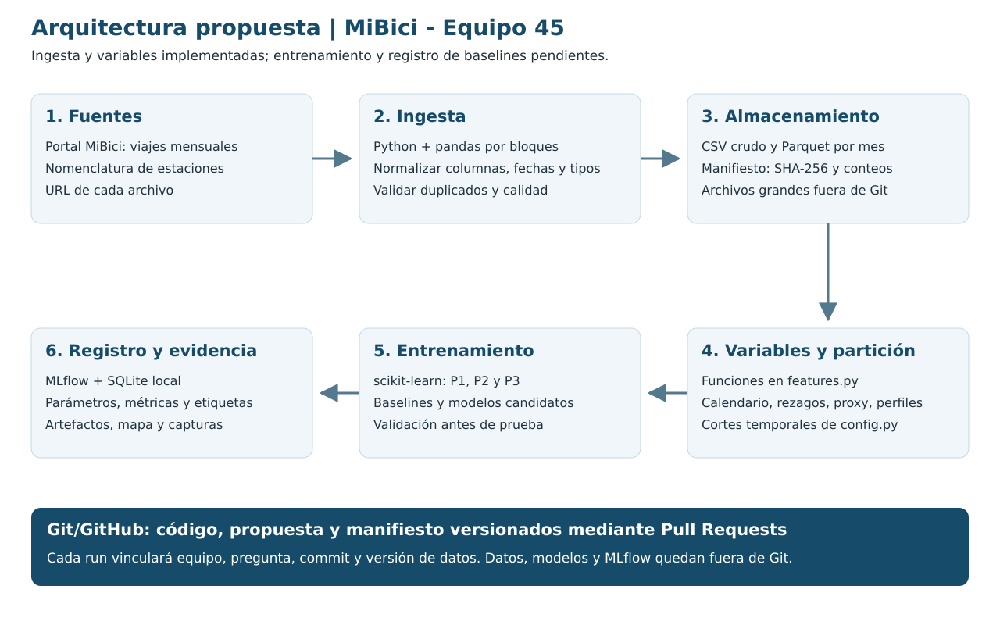

# Arquitectura propuesta

El diagrama describe el sistema del proyecto. Configuración, ingesta y variables están implementadas; entrenamiento y seguimiento de baselines siguen pendientes. La evidencia de ejecución está en [ingesta_features.md](ingesta_features.md).

| Componente | Herramienta y función | Justificación |
|---|---|---|
| Fuentes | CSV de viajes y nomenclatura del portal MiBici. | Fuente común de la actividad; cada descarga conservará su URL. |
| Ingesta | Python/pandas por bloques, en `dataset.py`. | Resolver variaciones de columnas sin cargar todos los meses a la vez. Calidad y preparación forman parte del diseño del sistema (Huyen, 2022). |
| Almacenamiento | CSV crudo local y Parquet mensual con PyArrow. | Conservar origen y facilitar lecturas parciales; archivos grandes fuera de Git. |
| Versionado | Manifiesto JSON con URL, SHA-256 y conteos, guardado en Git. | Ligar datos y código permite trazabilidad y reproducción del experimento (Treveil et al., 2020). |
| Preparación | pandas, funciones de `features.py` y cortes de `config.py`. | Separar exploración y lógica reutilizable sigue Cookiecutter Data Science y facilita revisar la información disponible al predecir. |
| Entrenamiento | scikit-learn para los tres baselines y candidatos. | Estimadores sencillos y métricas por tarea; selección en validación antes de prueba (Huyen, 2022). |
| Seguimiento | MLflow, SQLite y artefactos locales. | Registrar configuración, métricas, versiones y salidas. El equipo reproducirá las corridas o acordará un servidor compartido. |
| Evidencia | Matplotlib para gráficos/mapa y capturas reales de MLflow. | Interpretar errores/grupos y verificar runs, sin publicar atributos personales. |

Referencias completas en [propuesta.md](propuesta.md). Un clon de Git no contendrá la base ni los artefactos de experimentos ya ejecutados.
