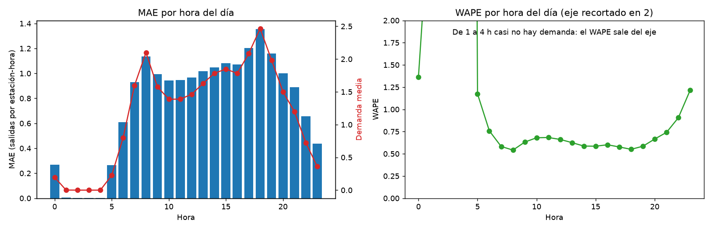
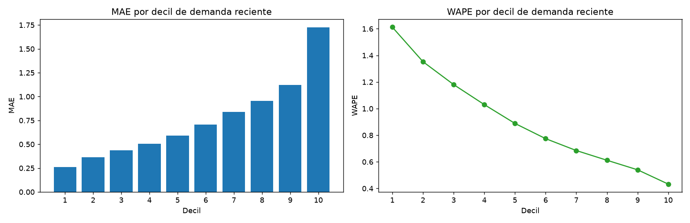
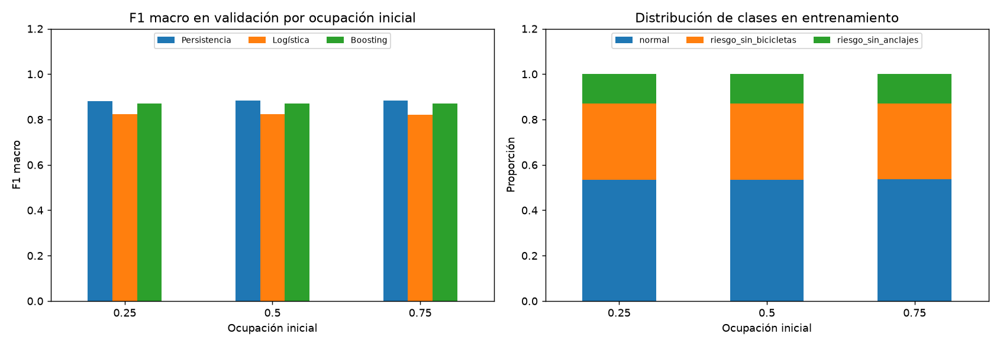
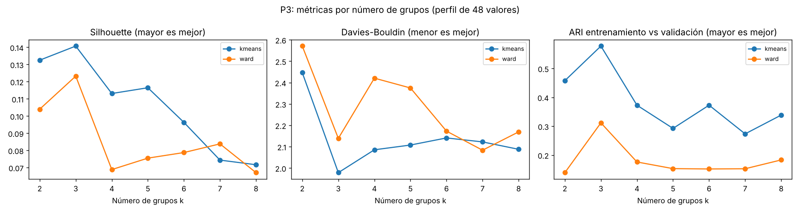

# Anexo: segunda iteración del experimento | Equipo 45

> **Portada (pendiente):** copiar nombres y matrículas de los integrantes desde `TC5061_Propuesta_Proyecto_Equipo45.pdf`.

## 1. Propósito y alcance

Este anexo complementa el documento principal (`TC5061_Propuesta_Proyecto_Equipo45.pdf`), que describe la primera iteración: seis corridas ejecutadas desde el commit `43bf339`, con `git_dirty=false`, y la evaluación única de septiembre para P1 y P2.

La segunda iteración se agregó **después** de esa evaluación. Todo lo que aquí se reporta usa solo validación (julio-agosto); septiembre no se volvió a usar. El protocolo declara cada adición en `references/protocolo_experimento.md`, y el detalle completo está en `reports/resultados_mlflow.md` y `reports/resultados_mlflow.json`.

## 2. Cambios incorporados

| Mejora | Qué agrega | Commit |
|---|---|---|
| Modelos guardados con firma | Cada run con estimador guarda el modelo en MLflow (`skops`) con su esquema de entrada y salida | `13a97f9` |
| Model Registry | `mibici-p1-demanda` y `mibici-p2-riesgo` con alias `champion`, elegido solo con métricas de validación | `13a97f9` |
| Inferencia | `python -m mibici.predict` carga el `champion` y predice una hora con las variables de `features.py` | `13a97f9` |
| Baseline de persistencia (P2) | Regla sin aprendizaje: la clase de la próxima hora es la de la ocupación virtual actual | `233d608` |
| Ajuste de hiperparámetros | Cuadrícula de 12 combinaciones del boosting en P1 y P2, solo validación (`--tune`) | `233d608` |
| Barrido de k (P3) | K-means y Ward con k de 2 a 8 | `e4d5e9d` |
| Estación categórica (P1) | `station_id` como variable categórica: 254 estaciones frecuentes y "otras" | `a4d5ac2` |
| Análisis de errores (P1) | Error por hora, decil de demanda y estación (`notebooks/2.0-analisis-errores-p1.ipynb`) | `e0dc21a` |
| Sensibilidad del proxy (P2) | P2 repetido con ocupación inicial de 25%, 50% y 75% | `f0acc9b` |

## 3. P1: demanda

| Run (validación) | val_mae | val_wape |
|---|---|---|
| P1_estacional_h1 (baseline) | 0.8988 | 0.7676 |
| P1_hgb_poisson_h1 (primera iteración) | 0.7614 | 0.6503 |
| P1_hgb_poisson_ajustado_h1 | 0.7552 | 0.6450 |
| **P1_hgb_poisson_estacion_h1 (`champion`)** | **0.7498** | **0.6403** |

La estación como variable categórica baja el MAE cerca de 1.5% sin ajustar hiperparámetros, más que el ajuste (0.8%). La ganancia es modesta: 43% de las filas de validación caen en la categoría "otras", y el RMSE sube ligeramente (1.4363 a 1.4446).

El análisis de errores muestra que el error absoluto sigue a la demanda (las horas pico reúnen 38% del error total), mientras que el error relativo se concentra en estaciones-hora de poca demanda: WAPE de 1.61 en el decil más bajo frente a 0.43 en el más alto. El sesgo medio es casi nulo (-0.003).

## 4. P2: riesgo virtual

| Run (validación) | val_f1_macro | val_balanced_accuracy | precisión / recall sin bicicletas | precisión / recall sin anclajes |
|---|---|---|---|---|
| **P2_persistencia_proxy_h1 (regla)** | **0.8824** | 0.8824 | 0.8877 / 0.8879 | 0.8439 / 0.8439 |
| P2_logistica_proxy_h1 | 0.8223 | 0.8856 | 0.7765 / 0.9394 | 0.6436 / 0.9502 |
| P2_hgb_proxy_h1 | 0.8708 | 0.9085 | 0.8622 / 0.9193 | 0.7264 / 0.9461 |
| P2_hgb_ajustado_proxy_h1 (`champion`) | 0.8723 | 0.9091 | — | — |

**Hallazgo principal:** la regla de persistencia supera al boosting en F1 macro, la métrica principal. El boosting detecta más situaciones de riesgo (mayor recall) a cambio de más falsas alarmas. La etiqueta y el predictor provienen de la misma simulación, así que la métrica mide sobre todo concordancia con el proxy. El sistema lo registra: la versión `champion` de `mibici-p2-riesgo` lleva la etiqueta `supera_baselines=no: P2_persistencia_proxy_h1`.

**Sensibilidad a la ocupación inicial:**

| Ocupación inicial | Persistencia F1 | Logística F1 | Boosting F1 |
|---|---|---|---|
| 25% | 0.8821 | 0.8226 | 0.8703 |
| 50% | 0.8824 | 0.8223 | 0.8708 |
| 75% | 0.8829 | 0.8215 | 0.8709 |

El F1 cambia menos de 0.0011 y el orden de los modelos no cambia: las conclusiones no dependen del supuesto inicial. Una explicación probable, no medida aparte, es que los unos 447 mil eventos recortados borran pronto el efecto del valor inicial. La estabilidad no valida el proxy frente a inventarios reales.

## 5. P3: número de grupos

| k | Silhouette (K-means) | ARI entre periodos (K-means) | Silhouette (Ward) | ARI entre periodos (Ward) |
|---|---|---|---|---|
| 2 | 0.1325 | 0.4578 | 0.1040 | 0.1390 |
| **3** | **0.1407** | **0.5776** | **0.1232** | **0.3116** |
| 4 | 0.1131 | 0.3726 | 0.0688 | 0.1760 |
| 5 | 0.1165 | 0.2923 | 0.0755 | 0.1530 |
| 6 | 0.0963 | 0.3728 | 0.0788 | 0.1518 |
| 7 | 0.0744 | 0.2734 | 0.0838 | 0.1526 |
| 8 | 0.0717 | 0.3384 | 0.0671 | 0.1831 |

k=3 tiene la mayor silhouette y el mayor ARI en ambos algoritmos, y distingue tres usos: pico matutino, pico vespertino y fin de semana. La silhouette máxima de 0.14 indica grupos superpuestos: es la mejor opción entre las probadas, no una separación nítida.

## 6. Trazabilidad y reproducción

La segunda iteración se reprodujo el 25 de octubre de 2026 en Windows (Python 3.13.16) con `python -m mibici.train --question all --tune` y `python -m mibici.sensitivity`. Los runs registran `git_commit=f0acc9b` y `git_dirty=true`. Los cambios sin confirmar eran solo documentales, más la fijación de `skops==0.16.0`, y se confirmaron en `b95118a`. Entre ambos commits no cambió ningún archivo `.py`, prueba ni manifiesto.

Los seis runs de la primera iteración, reejecutados en otra máquina y otro sistema operativo, reproducen sus métricas de validación y entrenamiento con diferencias menores a 1e-9.

| Modelo registrado | Versión | Alias | Run de origen | `supera_baselines` |
|---|---|---|---|---|
| `mibici-p1-demanda` | 1 | `champion` | `P1_hgb_poisson_estacion_h1` | si |
| `mibici-p2-riesgo` | 1 | `champion` | `P2_hgb_ajustado_proxy_h1` | no: `P2_persistencia_proxy_h1` |

## 7. Evidencia de MLflow

> **Pendiente:** insertar las capturas al generarlas.

## 8. Conclusiones y límites

- **P1:** el `champion` mejora al baseline estacional en 17% de MAE de validación (0.8988 a 0.7498). El error relativo alto proviene de las horas de poca demanda.
- **P2:** el aprendizaje no supera a la persistencia en la métrica principal. Con este proxy, el valor del boosting está en el recall de riesgo, no en el F1; validar P2 requiere inventarios observados.
- **P3:** k=3 queda respaldado, con grupos superpuestos.
- **MLOps:** los modelos quedan guardados con firma, versionados en el Model Registry y consumibles con `predict.py`; la elección del `champion` usa solo validación y avisa cuando un baseline lo supera.
- **Límite:** los modelos de la segunda iteración no se evaluaron en septiembre. Hacerlo exigiría una única evaluación declarada en el protocolo.
