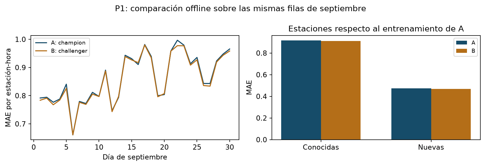

# A/B offline de P1

Comparación offline retrospectiva de versiones registradas de P1.

- Run de comparación: `7a429366dfcd415e80e0a167217deebe`.
- Evaluación común: 338,690 filas, 471 estaciones.
- A: `models:/mibici-p1-demanda/1`, entrenamiento hasta 2026-07-01 (exclusivo).
- B: `models:/mibici-p1-demanda/2`, entrenamiento hasta 2026-09-01 (exclusivo).

| Modelo | MAE | RMSE | WAPE | R² |
|---|---|---|---|---|
| A | 0.862040 | 1.668304 | 0.597064 | 0.642540 |
| B | 0.857719 | 1.611107 | 0.594071 | 0.666630 |

WAPE se expresa como proporción; multiplicar por 100 para porcentaje.

| Segmento respecto a A | Filas | Estaciones | MAE A | MAE B |
|---|---|---|---|---|
| known | 297,360 | 413 | 0.916137 | 0.911665 |
| new | 41,330 | 58 | 0.472829 | 0.469591 |

Mejora MAE A-B: 0.004321; IC 95% [0.002236, 0.006238].
Bootstrap pareado circular: bloques de 7 días, 5000 réplicas, semilla 42.

Regla: MAE menor, IC95 de mejora positivo, RMSE y MAE de estaciones nuevas sin empeorar.
Versión recomendada: **challenger**. La comparación no modifica ningún alias.

- mae_improves: cumple.
- ci_excludes_no_improvement: cumple.
- rmse_does_not_worsen: cumple.
- new_stations_do_not_worsen: cumple.

## Alcance y Continuous Training

Es una comparación offline retrospectiva, no un experimento de tráfico aleatorio. Septiembre ya se había observado en entregas anteriores y en el entrenamiento del challenger; ninguna versión lo usó para ajustar sus pesos. No se cambian hiperparámetros después de esta comparación. El intervalo describe la variabilidad del mes bajo bloques semanales; no demuestra generalización a meses futuros.

Mantener monitoreo mensual y revisar calidad antes de entrenar. Un cambio de station_id o de demanda reciente abre una revisión; no mueve champion por sí solo. Entrenar con información anterior al nuevo periodo de evaluación, comparar con MAE y los controles de RMSE/estaciones nuevas, y promover una versión solo con evidencia favorable en un periodo posterior. Conservar la versión previa para revertir si empeora la operación.
