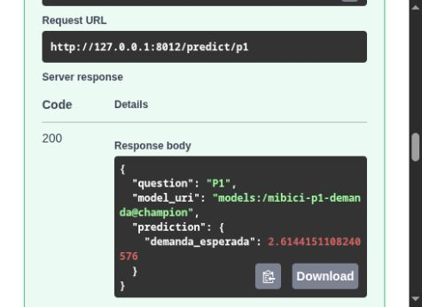

# Verificación independiente de la API en Docker

**Fecha:** 6 de noviembre de 2026. **Autor:** Leonardo Peraza Alavez, A01840326.

Se construyó y ejecutó el servicio de los PR #15–#18 desde un clon de GitHub en `6369efba942b6bc5a7d3c1ac3dc91b99a3d4b938`. Después se construyó otra imagen con los controles de salida y el verificador HTTP de esta rama. El `Containerfile` y `requirements-api.txt` son los de Franco, sin modificaciones. La evidencia de Podman en Windows permanece en el README principal.

## Resultado

| Comprobación | Resultado observado |
|---|---|
| Imagen desde `main` | Construcción y ejecución correctas con Docker 29.8.0, Linux amd64, Python 3.13.15. |
| Imagen con esta revisión | Construcción correcta; proceso de la API como usuario 1000, sin montar datos ni modelos. |
| Registry externo a la API | Otro contenedor MLflow 3.17.2 en una red dedicada, con copia de la base histórica y artefactos montados en modo de solo lectura. |
| P1 | HTTP 200, demanda `2.6144151108240576`. |
| P2 | HTTP 200, clase 1, `riesgo_sin_bicicletas`, salidas `[0.0, 1.0, 0.0]`. |
| Comparación | Las dos imágenes producen las mismas respuestas; P1 y P2 coinciden con la inferencia directa de los modelos recuperados por alias. |
| Entradas inválidas | Hora fuera de rango, entero como texto, rezago negativo, calendario incoherente, estación ausente, campo extra y ocupación fuera de rango: HTTP 422. |
| API sin Registry configurado | `/health` y OpenAPI: 200; ambas predicciones: 503; las entradas inválidas: 422. |
| Controles HTTP | 11 sobre la imagen de `main`, 11 sobre la imagen final y 11 sobre la instancia sin Registry: 33 aprobados. |
| Regresión del código | 234 pruebas aprobadas, más 12 subpruebas; 221 avisos de dependencias. |

La comparación numérica usa tolerancia absoluta de `1e-12`. P2 es el baseline de persistencia del inventario virtual; sus salidas 0/1 representan la regla y no probabilidades calibradas de inventario real.

## Modelos recuperados

| Pregunta | Nombre en Registry | Versión | Alias | Run de entrenamiento |
|---|---|---|---|---|
| P1 | `mibici-p1-demanda` | 1 | `champion` | `da28d047b8384d089de6f74fcd4e175d` |
| P2 | `mibici-p2-riesgo` | 1 | `champion` | `fb52c91b260843a992fe74ecfac7201c` |

Ambos runs conservan el commit de entrenamiento `92e305f3de71dada5853035ba0081401aad197be`. Se utilizó una copia de la base para permitir su apertura con la versión actual de MLflow. El SHA-256 de la base original permaneció en `6b8caa054c8ddfe54eb83d5ca01762c6de7403f15a35c2324993db8629f5e2d9`.

La API recibe `MLFLOW_TRACKING_URI=http://mibici-registry-verificacion:5000`. Los modelos se descargan por HTTP desde el Registry y su servidor de artefactos. El puerto del Registry no se publica al anfitrión; la API final se publica solo en `127.0.0.1:8012`. El alias puede cambiar: la tabla registra las versiones resueltas durante esta ejecución.

## Repetir la verificación

Para crear un Registry nuevo a partir de los datos públicos, sigue los pasos de servidor y entrenamiento del [README](../../README.md#despliegue-en-contenedor-con-podman). No se necesita la base privada de esta prueba. Luego construye y ejecuta el contenedor y usa el verificador contra su URL. Las predicciones pueden cambiar al entrenar o promover otra versión; el verificador comprueba el contrato del servicio y no exige un valor fijo de demanda.

Con Podman se conservan los comandos del README. Con Docker Desktop, inicia MLflow como allí se indica, incluyendo `host.docker.internal:5000` en `--allowed-hosts`, y ejecuta:

```text
docker build -t mibici-api -f Containerfile .
docker run --rm -p 127.0.0.1:8000:8000 -e MLFLOW_TRACKING_URI=http://host.docker.internal:5000 mibici-api
```

En Docker Engine sobre Linux, añade `--add-host=host.docker.internal:host-gateway` a `docker run` para resolver ese nombre. El servidor MLflow debe escuchar en una interfaz accesible desde el contenedor y permitir ese host. Cuando MLflow esté en otro servidor, sustituye la URI por su dirección.

Desde otra terminal, en la raíz del repositorio y con `requirements-api.txt` instalado:

```text
python -m mibici.verify_api --base-url http://127.0.0.1:8000 --output reports/deployment/verificacion_local.json
```

El comando funciona en PowerShell, CMD, Linux y macOS. Escribe JSON y termina con código 0 si los once controles pasan, o 1 si alguno falla. `--timeout` establece los segundos máximos por petición. Los ejemplos de entrada están en `mibici/verify_api.py` y corresponden a los del README.

Para probar la ausencia de configuración, inicia otra instancia desde la misma imagen:

```text
docker run --rm -p 127.0.0.1:8001:8000 mibici-api
python -m mibici.verify_api --base-url http://127.0.0.1:8001 --unavailable
```

`--unavailable` espera 503 en ambas predicciones. No debe usarse para certificar una instancia con modelos disponibles. `/health` comprueba únicamente el proceso.

## Corrección de validación de salida

La revisión añadió las restricciones de salida que faltaban en Pydantic: demanda finita y no negativa; probabilidades finitas entre 0 y 1, suma de uno con tolerancia absoluta de `1e-6` y coherencia entre clase, riesgo y probabilidad máxima. Una salida que incumpla el contrato produce 503 con un mensaje genérico.

Las nueve pruebas de `tests/test_verify_api.py` comprueban el verificador con las rutas reales de FastAPI, distinguen salud del proceso y disponibilidad del modelo, provocan salidas negativas/no finitas o probabilidades inválidas y verifican el código de salida ante un fallo. Los modelos dobles se usan únicamente en esas pruebas unitarias; las peticiones de esta evidencia usan los modelos reales de la tabla anterior.

## Archivos de evidencia

- [Resultados HTTP, comparación directa, contenedores, imágenes y hashes de código](verificacion.json). La respuesta de OpenAPI se resume a las operaciones comprobadas; las respuestas de predicción y de error se conservan completas.
- [Salida de construcción desde `main`](docker_build_main.txt).
- [Salida de construcción de la imagen final](docker_build_final.txt).
- [Resumen de pruebas, lint, documentación y seguridad](calidad.json).
- [Captura de Swagger con la respuesta de P1 desde Docker](docker_p1.png).

Los hashes de `api.py`, `schemas.py` y `verify_api.py` identifican el código incorporado a la imagen final antes de crear el commit. Los cambios posteriores de Markdown y las evidencias no forman parte de la aplicación empaquetada. Los datos, bases de MLflow y modelos serializados permanecen fuera de Git.



La prueba de Docker cubre Linux amd64; la evidencia previa de Franco cubre Podman en Windows. Las versiones directas de las dependencias están fijadas y el log registra las transitivas resueltas en esta construcción. Se trata del despliegue local de esta actividad, sin autenticación ni prueba de carga.

Referencias: [FastAPI en contenedores](https://fastapi.tiangolo.com/deployment/docker/) y [flujo de Model Registry de MLflow](https://mlflow.org/docs/latest/ml/model-registry/workflow/).
