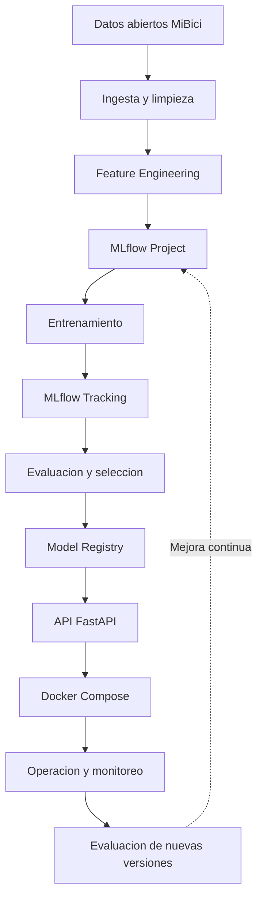

# Consolidación del repositorio — Proyecto integrador MiBici

**Equipo:** 45
**Actividad:** Entrega final del proyecto integrador
**Alcance:** Punto 1 — Consolidación del repositorio
**Commit de referencia original:** 2671c33
**Cierre:** 26 de noviembre de 2026, código base `d4bb784`. Véase la
[revalidación funcional final](revalidacion_20261126.md).

## 1. Objetivo

Consolidar y verificar la estructura técnica del proyecto MiBici, integrando las prácticas de ingeniería de software, ciencia de datos y MLOps desarrolladas durante el curso.

La revisión comprende la organización del repositorio, la preparación de datos, el feature engineering, la ejecución mediante MLflow Projects y el seguimiento de experimentos con MLflow Tracking.

## 2. Descripción del proyecto

MiBici utiliza datos abiertos del sistema de bicicletas públicas para desarrollar modelos de Machine Learning orientados a tres problemas:

| Modelo | Tipo de aprendizaje | Objetivo |
|---|---|---|
| P1 | Regresión | Predicción de demanda de bicicletas. |
| P2 | Clasificación | Estimación del riesgo de disponibilidad. |
| P3 | Clustering | Identificación de perfiles de estaciones. |

El proyecto integra componentes para el entrenamiento, registro, despliegue, operación y monitoreo de los modelos.

Fuente de datos: https://mibici.net/es/datos-abiertos/

## 3. Estructura del repositorio

El repositorio conserva una organización basada en Cookiecutter Data Science, ampliada para incorporar los componentes de MLOps desarrollados durante el curso.

| Componente | Responsabilidad |
|---|---|
| `mibici/` | Código fuente y lógica del proyecto. |
| `models/` | Espacio destinado a modelos. |
| `notebooks/` | Exploración y análisis experimental. |
| `reports/` | Reportes, métricas y evidencias. |
| `references/` | Documentación técnica de referencia. |
| `docs/` | Documentación del proyecto. |
| `tests/` | Pruebas automatizadas. |
| `load/` | Escenarios de pruebas de carga. |
| `.github/workflows/` | Automatización mediante GitHub Actions. |
| `MLproject` | Definición de los puntos de entrada de MLflow Projects. |
| `python_env.yaml` | Configuración del entorno de ejecución. |
| `pyproject.toml` | Configuración del proyecto Python. |
| `requirements.txt` | Dependencias del proyecto. |
| `README.md` | Documentación principal. |
| `docker-compose.yml` | Orquestación de servicios. |
| `Containerfile` | Construcción de la imagen del servicio. |

Esta separación facilita la colaboración, el mantenimiento, la trazabilidad y la reproducibilidad del sistema.

## 4. Ingesta y preparación de datos

La lógica de ingesta se encuentra en `mibici/dataset.py`, mientras que la generación de variables se encuentra en `mibici/features.py`.

El procesamiento permite transformar los datos históricos de viajes en conjuntos de características destinados al entrenamiento y evaluación de los modelos P1, P2 y P3.

### 4.1 Evidencia de ejecución

El repositorio contiene evidencia de una ejecución realizada desde un clon limpio el 18 de noviembre de 2026.

| Indicador | Resultado documentado |
|---|---:|
| Registros originales | 3,362,065 |
| Viajes después de limpieza | 3,358,273 |
| Registros removidos | 3,792 |
| Meses procesados | 9 |
| Pruebas Pytest superadas | 273 |

Estos resultados corresponden a una ejecución previa documentada por el equipo, no a una nueva ejecución realizada durante esta revisión final.

Evidencia: [Ingesta desde clon limpio](../ingesta_clon_limpio_20261118.json).

### 4.2 Feature Engineering

La generación de características constituye la conexión entre los datos originales y los modelos predictivos.

El proyecto incorpora variables relacionadas con el comportamiento histórico de las estaciones y los patrones de utilización del sistema.

La separación de la preparación de datos y el entrenamiento permite reutilizar las transformaciones y reducir inconsistencias entre experimentos.

Archivos de referencia:

- [Código de ingesta](../../mibici/dataset.py).
- [Feature Engineering](../../mibici/features.py).
- [Documentación de ingesta y variables](../../references/ingesta_features.md).

### 4.3 Consideraciones de reproducibilidad

La evidencia histórica indica que la actualización del catálogo de estaciones modificó las tablas de características de P2 y P3.

Por lo tanto, debe distinguirse entre la capacidad de ejecutar nuevamente el pipeline y la reproducción exacta de los resultados históricos.

Para garantizar una reproducción exacta se recomienda conservar las versiones de los datos originales, el catálogo de estaciones, las características generadas y las dependencias utilizadas.

## 5. Consolidación mediante MLflow Projects

El archivo `MLproject` establece una interfaz estandarizada para ejecutar los procesos principales del proyecto.

| Entry point | Función |
|---|---|
| `ingest` | Ingesta y preparación de datos. |
| `train` | Entrenamiento parametrizado. |
| `verify` | Verificación de los modelos registrados. |

El entorno de ejecución se define mediante `python_env.yaml`.

### 5.1 Parametrización del entrenamiento

El punto de entrada `train` permite configurar parámetros como:

- `question`: problema de Machine Learning.
- `model`: modelo seleccionado.
- `seed`: semilla de reproducibilidad.
- `learning_rate`: tasa de aprendizaje.
- `max_iter`: número máximo de iteraciones.
- `max_leaf_nodes`: complejidad del modelo.
- `l2_regularization`: regularización.
- `c`: parámetro de regularización aplicable.
- `n_clusters`: número de grupos.
- `tune`: ajuste de hiperparámetros.
- `final_test`: evaluación final.
- `register`: registro del modelo.
- `train_window`: ventana de entrenamiento.

La parametrización permite realizar diferentes experimentos sin modificar directamente el código fuente.

### 5.2 Comandos de referencia

Desde la raíz del repositorio y con el entorno correspondiente configurado:

```bash
mlflow run . -e ingest
```

Entrenamiento:

```bash
mlflow run . -e train
```

Verificación de los modelos registrados:

```bash
mlflow run . -e verify
```

Estos comandos se derivan de los puntos de entrada definidos en MLproject. Su ejecución requiere las dependencias, los datos y la configuración de MLflow correspondientes.

Antes de ejecutar el entrenamiento debe revisarse la configuración del parámetro `register`, para evitar modificaciones no intencionadas en el Registry compartido.

Referencias:

- [MLproject](../../MLproject).
- [Entorno de Python](../../python_env.yaml).
- [Implementación del proyecto](../../mibici/project.py).

## 6. Seguimiento de experimentos con MLflow Tracking

MLflow Tracking permite conservar información asociada con las ejecuciones de entrenamiento, incluyendo parámetros, métricas, artefactos e identificadores de ejecución.

El código de seguimiento se encuentra en `mibici/tracking.py`, mientras que la lógica de entrenamiento se encuentra en `mibici/train.py`.

### 6.1 Trazabilidad experimental

La información registrada permite relacionar:

- El código fuente utilizado.
- La versión de los datos.
- La versión de las características.
- Los parámetros de entrenamiento.
- Las métricas de evaluación.
- Los artefactos generados.
- La ejecución de entrenamiento mediante su Run ID.
- El modelo registrado y su versión.

Esta información facilita la comparación de experimentos y la identificación del origen de los modelos.

### 6.2 Resultados experimentales históricos

Los resultados documentados en entregas anteriores incluyen:

#### P1 — Regresión

| Modelo | MAE de validación |
|---|---:|
| Baseline estacional | 0.898799 |
| HistGradientBoosting | 0.761427 |
| Modelo ajustado | 0.7552 |
| Champion definitivo con estación | 0.749792 |

El champion definitivo con estación obtiene el menor MAE de validación. El modelo
ajustado de las filas anteriores corresponde a otro experimento y no es el elegido.

#### P2 — Clasificación

| Modelo | F1 macro de validación |
|---|---:|
| Regresión logística | 0.822339 |
| HistGradientBoosting | 0.870816 |
| Modelo ajustado | 0.8723 |
| Baseline de persistencia | 0.882361 |

El baseline de persistencia presenta un F1 macro superior al modelo ajustado. La selección del modelo debe considerar adicionalmente los objetivos operativos, el recall y las falsas alarmas.

#### P3 — Clustering

| Modelo | Silhouette de entrenamiento |
|---|---:|
| K-means | 0.140695 |
| Ward | 0.123216 |

La métrica Silhouette permite analizar la separación y cohesión de los grupos. Estos resultados no constituyen por sí solos una demostración de la superioridad operativa de un modelo.

Las métricas anteriores corresponden a experimentos históricos y no deben confundirse con los resultados posteriores del A/B testing.

### 6.3 Evidencias de MLflow Tracking

- [Resultados experimentales](../resultados_mlflow.md).
- [Código de Tracking](../../mibici/tracking.py).
- [Código de entrenamiento](../../mibici/train.py).
- [Evidencia de ejecuciones anidadas](../figures/entrega2/nested_runs.jpg).
- [Artefactos registrados](../figures/entrega2/artefactos.jpg).
- [Firma del modelo](../figures/entrega2/firma_modelo.jpg).

## 7. Integración del ciclo de vida de MLOps

La estructura consolidada permite conectar las diferentes etapas del proyecto:



La integración permite conectar el desarrollo experimental con los componentes de despliegue, operación y monitoreo.

## 8. Matriz de cumplimiento

| Requerimiento | Evidencia | Estado |
|---|---|---|
| Estructura Cookiecutter | Organización del repositorio | Revisado |
| Ingesta de datos | dataset.py y evidencia histórica | Revisado |
| Feature Engineering | features.py y documentación | Revisado |
| MLflow Project | MLproject | Revisado |
| Entorno de ejecución | python_env.yaml | Revisado |
| Entrenamiento parametrizado | MLproject y train.py | Revisado |
| MLflow Tracking | tracking.py y reportes | Revisado |
| Pruebas automatizadas | 316 pruebas y 16 subpruebas aprobadas el 26 de noviembre | Comprobado |
| Reproducción de métricas históricas | Código de origen y hashes de las tablas originales | Comprobado |
| Ejecución funcional con código actual | MLflow Project, modelos reales y Compose; evidencia de cierre | Comprobado |

## 9. Recomendaciones

1. Conservar versiones identificables de los datos y catálogos de estaciones.
2. Mantener actualizadas las dependencias del entorno de ejecución.
3. Documentar los cambios en las características utilizadas por los modelos.
4. Mantener la separación entre entrenamiento, validación y prueba.
5. Conservar los identificadores de las ejecuciones y los commits asociados.
6. Verificar el funcionamiento del pipeline desde un entorno limpio antes de la entrega final.
7. Mantener actualizada la documentación cuando se incorporen nuevas versiones de modelos.
8. Evitar modificaciones no controladas de los aliases del Model Registry.

## 10. Conclusión

El proyecto MiBici cuenta con una estructura organizada y con los componentes técnicos necesarios para integrar la preparación de datos, el entrenamiento parametrizado y el seguimiento de experimentos mediante MLflow.

La evidencia histórica demuestra avances en la ejecución reproducible del proyecto y en la automatización de pruebas.

La [revalidación del 26 de noviembre](revalidacion_20261126.md) añade ejecución funcional
al examen documental: recuperación de modelos reales con el código actual, reproducción
de métricas con el código histórico compatible y ejecución del MLflow Project con una
versión nueva de datos. El registro mantiene la identidad de cada versión; descargar un
catálogo distinto no convierte una tabla nueva en la que produjo los modelos históricos.

La [verificación del Registry](validacion_registry.md) conserva el linaje, los resultados
de predicción y la decisión sobre los modelos consumidos por el prototipo de entrega.
