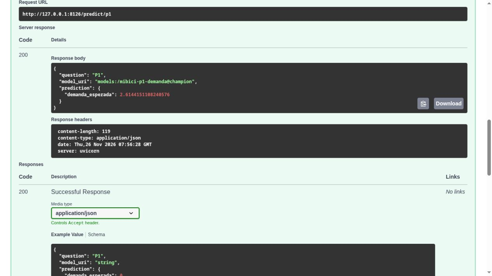

# Revalidación final de MiBici

**Equipo:** 45
**Fecha:** 26 de noviembre de 2026
**Código base:** `d4bb7849210b05f5d025165362695373f9dd5c76`
**Alcance:** ejecución local con modelos reales y datos versionados; no consulta un
servidor privado de otro integrante ni representa una implementación pública en nube.

## Resultado del cierre

| Componente | Comprobación | Resultado |
|---|---|---|
| MLflow Project actual | Ingesta y variables desde datos vacíos | Run `315c65d7398f4f89a31f0c80d2ebe72d` FINISHED |
| Model Registry real de referencia | P1/P2/P3 v1, firma y linaje | Tres modelos recuperados |
| Predicciones de referencia | Cinco filas por champion y por challenger P1 | Coinciden con tolerancia 1e-12 |
| Métricas históricas | Código y tablas de origen compatibles | Reproducidas |
| A/B retrospectivo | Métricas, filas e intervalo de confianza | Coinciden con la evaluación original |
| Evidently | Cuatro comparaciones, todas las filas | Mismos resultados de drift y calidad |
| Compose con modelos reales | API y Registry saludables; reinicio con volumen | 22/22 controles HTTP |
| Locust con Docker | 5 usuarios/60 s y 100 usuarios/120 s | Ambos escenarios cumplen |
| Pytest | Código actual, entorno del proyecto | 316 pruebas y 16 subpruebas aprobadas |
| CI integrado | Cuatro jobs del commit base en main | success |

## 1. Datos y reproducción

El código se extrajo con `git archive` a una carpeta nueva sin datos. La ejecución del
MLflow Project descargó los nueve meses seleccionados, descubrió el catálogo vigente y
generó las tablas P1/P2/P3. Se utilizó el entorno local con dependencias fijadas.

```text
python -m mlflow run . -e ingest --env-manager local --experiment-name mibici-equipo45
```

El run `315c65d7398f4f89a31f0c80d2ebe72d` terminó en FINISHED. Se obtuvieron 3,362,065 registros originales y
3,358,273 viajes válidos. El catálogo vigente contiene 470 estaciones y se observaron
471 IDs en viajes. Los hashes de los viajes originales y limpios coinciden con los
históricos. Los datos nuevos tienen versión `85fa5af8030a91135df4e4d84f5abd96399cb9040515b4c60519a3d1d140f97e` y las
variables `a6d5c3e01bf87c807484d54b8ffd8bf86944b011a2e853ff7b9d588784c3d13b`.

La tabla P1 conserva su SHA-256; P2 y los archivos P3 difieren por el catálogo. Los
[manifiestos nuevos](evidencias_20261126/data_manifest_nueva_ejecucion.json) se conservan
como evidencia separada y no sustituyen los de entrenamiento de los modelos históricos.
[Resultados de ingesta](evidencias_20261126/ingesta_actual.json).

El verificador completo de main bloqueó el uso de las tablas antiguas con la configuración
nueva de ingesta. Es un control de trazabilidad: no se omite ni se reetiquetan datos.
Para reproducir las métricas históricas se utilizó el código `92e305f`, cuyos hashes de
configuración y variables coinciden con los manifiestos y con todos los Parquet preservados.
La recuperación y las predicciones de esos modelos sí se verificaron con el código actual.
[Correspondencia de versiones](evidencias_20261126/versiones_reproduccion.json).

## 2. Registry, linaje y decisión de servicio

Se usó una copia de la base del registro histórico y sus artefactos reales, con servidor
MLflow HTTP local. La base de origen y sus aliases se conservaron. El registro de
referencia contiene:

| Modelo | Champion | Run de entrenamiento | Estado |
|---|---|---|---|
| mibici-p1-demanda | 1 | `da28d047b8384d089de6f74fcd4e175d` | READY |
| mibici-p2-riesgo | 1 | `fb52c91b260843a992fe74ecfac7201c` | READY |
| mibici-p3-grupos | 1 | `1079f92ad21d4f2cbc7dfa29c0d01253` | READY |

La consulta comprobó experimentos, commits, firmas, parámetros y versiones de datos y
características. P1/P2 tienen diez y doce entradas respectivamente; P3 utiliza los 48
predictores de perfiles. El registro de la reproducción A/B se consulta por separado:
P1 v1 es champion y P1 v2 es challenger, con runs `a9284a97452a4a2383b1ca148d9a15c7` y
`ad655fdb19c042a190b794e084684c8c`. Los números de versión no se equiparan entre registros.

```text
python -m mibici.verify_registry --question all --smoke-only --output reports/final/registry_local.json
python -m mibici.verify_registry --question P1 --alias challenger --smoke-only
```

El segundo comando requiere apuntar al registro A/B. El primero se ejecutó contra el
registro de referencia. Las cinco predicciones por modelo y las probabilidades de P2
coincidieron con sus ejemplos guardados. La evaluación histórica completa reprodujo:

| Modelo | Métrica de validación reproducida | Filas |
|---|---|---:|
| P1 | MAE 0.7497917145254663 | 665,747 |
| P2 | F1 macro 0.882361022824495 | 662,771 |
| P3 | Silhouette de asignación 0.12276800634549838; Davies-Bouldin 2.2114579777123864 | 468 |

El ARI 0.577564 de selección de P3 describe estabilidad entre ajustes de periodos. Las
métricas de asignación de la tabla describen aplicar el modelo ya congelado a validación;
son comprobaciones diferentes.

**Decisión de entrega:** la API conserva los champion v1 de P1/P2 y P3 v1 opera por lotes.
La reproducción A/B confirma la ventaja retrospectiva de P1 v2: MAE 0.857719 frente a
0.862040, mejora absoluta 0.004321 e IC 95 % [0.002236, 0.006238]. La promoción queda
condicionada a evaluación en otro periodo y revisión técnica. Esta ejecución no movió
aliases. P2 conserva la persistencia porque ganó en F1 macro y menor costo.

Fuentes: [linaje](evidencias_20261126/registry_linaje.json),
[smoke tests](evidencias_20261126/registry_smoke_test.json),
[métricas históricas](evidencias_20261126/registry_validacion_historica.json) y
[A/B reproducido](evidencias_20261126/ab_reproduccion.json).

## 3. API y persistencia

Se construyó `mibici-api:final-20261126` con el Containerfile del código base y Docker
29.8.0. El proyecto Compose aislado utiliza puertos 8126 (API) y 5226 (Registry).
El paquete P1/P2 se exportó desde el registro real de referencia y se verificó antes de
la importación. La API corre como UID 1000 y conserva sus límites de 2 CPU / 1 GiB.

```text
docker compose up --build -d --wait --wait-timeout 240
python -m mibici.verify_api --base-url http://127.0.0.1:8126 --output reports/final/http-local.json
```

El comando de esta campaña añadió `-p mibici-final-20261126`, `API_PORT=8126`,
`MLFLOW_PORT=5226`, `MIBICI_IMAGE` y la ubicación del paquete exportado mediante variables
de entorno. La guía [operacion_compose.md](../../references/operacion_compose.md) muestra
la preparación y las variantes de terminal. Los valores por defecto del repositorio son
8000/5000; el cambio de puerto se usa únicamente para aislar esta comprobación.

Los once controles HTTP iniciales y los once posteriores a `down`/`up` sin eliminar el
volumen aprobaron. Se conservaron una versión de P1/P2 y sus aliases; registry-init no
creó duplicados. Para el ejemplo documentado, P1 devuelve `2.6144151108240576` y P2 devuelve la
clase `riesgo_sin_bicicletas`. Siete entradas inválidas por comprobación devuelven 422.
Swagger ejecutó además una petición real con HTTP 200.



Fuentes: [Compose](evidencias_20261126/compose.json),
[HTTP inicial](evidencias_20261126/http-real.json) y
[HTTP tras recrear servicios](evidencias_20261126/http-real-restart.json).

## 4. Carga y recursos

Campaña local del 26 de noviembre, Docker Desktop sobre Linux, Intel Core Ultra 9 285K,
24 CPU y aproximadamente 8 GiB en la VM. Locust 2.46.0 comparte anfitrión con el servidor.
La mezcla de tareas y los límites de aceptación son los del código versionado; los
rechazos 422 esperados comprueban validación. No se suman como inferencias útiles.

```text
python -m mibici.load_test --host http://127.0.0.1:8126 --scenario baseline estres --stats docker --output reports/carga_local
```

| Escenario | Usuarios | Duración | RPS totales | p95 | Errores |
|---|---:|---:|---:|---:|---:|
| Baseline | 5 | 60 s | 15.79 | 8 ms | 0 % |
| Estrés | 100 | 120 s | 280.08 | 200 ms | 0 % |

En estrés P1/P2 suman 224.03 predicciones válidas/s. La API alcanzó 247.7 MiB y un
máximo de CPU de 142.93 % (1.43 núcleos). MLflow alcanzó 376.6 MiB, después del ajuste
que desactiva sus trabajos en segundo plano. El muestreo obtuvo 31 y 61 lecturas por
servicio, aproximadamente cada 2 s, sin errores del monitor.

Esta campaña agrega evidencia posterior a la corrección de memoria. Se mantiene separada
de las campañas Docker del 20 y Podman/WSL2 del 21 de noviembre, hechas en otras
condiciones. No acredita capacidad máxima absoluta, estabilidad prolongada, renovación
de caché en un periodo largo ni rendimiento equivalente en nube.

Fuentes: [resumen](evidencias_20261126/locust/resumen.md),
[Locust baseline](evidencias_20261126/locust/baseline.html) y
[Locust estrés](evidencias_20261126/locust/estres.html).

## 5. Monitoreo y FinOps

Evidently reprodujo las cuatro comparaciones históricas: ninguna tiene drift global,
pero station_id presenta drift en P1/P2 y aparecen 58 estaciones nuevas en septiembre.
Las distancias y los controles de calidad coinciden con el resumen original. Se mantiene
la evaluación por variable y la revisión mensual, con promoción separada de la alerta.
[Resumen reproducido](evidencias_20261126/evidently_resumen.json).

Se consultaron de nuevo los archivos oficiales de AWS, publicados el 24 y consultados
el 26 de noviembre: c6i.xlarge Linux cuesta USD 0.1700/h en us-east-1 y 0.1785/h en
mx-central-1. Son USD 124.10 y 130.31 por 730 horas. La tarifa es una referencia de
cómputo, no una factura observada.

Con q = 224.03 predicciones válidas/s, extrapolar el rendimiento local da
USD 0.00021079 por 1,000 inferencias en Virginia.
El supuesto de 480 estaciones × 24 h × dos modelos implica 23,040 inferencias diarias
y USD 0.17708 por 1,000 con la instancia siempre encendida. Las 480 estaciones son
una hipótesis de planificación, no el conteo del catálogo vigente. El cálculo excluye
EBS, red, IP pública, balanceador e impuestos. t3.large y los horarios reducidos son
opciones de ahorro sujetas a capacidad, créditos de CPU y necesidad operativa.

Fuentes: [tarifas verificadas](evidencias_20261126/precios_aws.json),
[cálculos de la revalidación](evidencias_20261126/finops_revalidacion.json) y
[análisis FinOps completo](../finops/analisis_costos.md).

## 6. Calidad e integración

Las pruebas locales aprobaron 316 casos y 16 subpruebas. Se mantuvieron las 243
advertencias de dependencias como información de mantenimiento, sin fallos de pruebas.
La ejecución CI [45771834486](https://github.com/A01793289-Franco/mna-mibici-equipo45/actions/runs/45771834486)
del commit base en main aprobó Ubuntu, Windows, seguridad y despliegue Compose con
modelos sintéticos. Las evidencias reales de esta página complementan ese control.

El análisis local aprobó Flake8, MkDocs estricto, la revisión de secretos e historial y Bandit sin hallazgos de severidad media o alta. pip-audit no encontró vulnerabilidades adicionales a las excepciones ya documentadas en el proyecto; se mantuvo la misma política del CI. [Resultado de calidad](evidencias_20261126/calidad_codigo.json).

El PR #32 de Aldo está fusionado mediante `2cf05db`; el PR #33 de Franco añadió el
Model Card y está fusionado en `d4bb784`. Este cierre conserva sus contribuciones,
actualiza la documentación y agrega las ejecuciones verificables.

La presentación final y su guion se distribuyen fuera del repositorio. La entrega en
Canvas incluye el enlace al proyecto, la presentación y el video continuo de 2 a 5 minutos.
