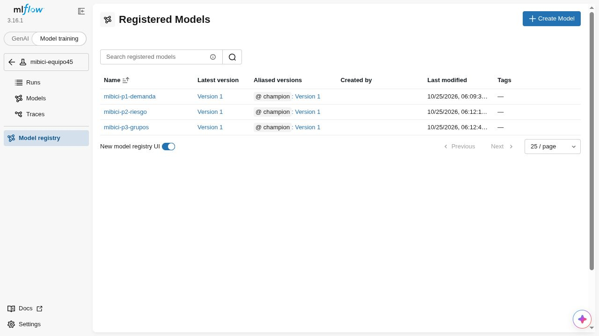
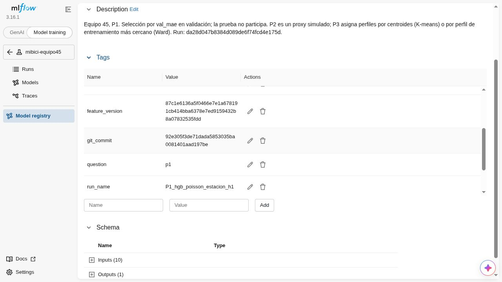
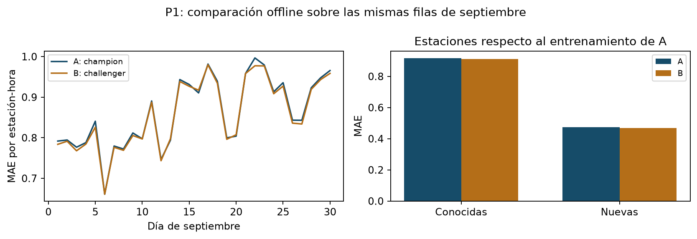
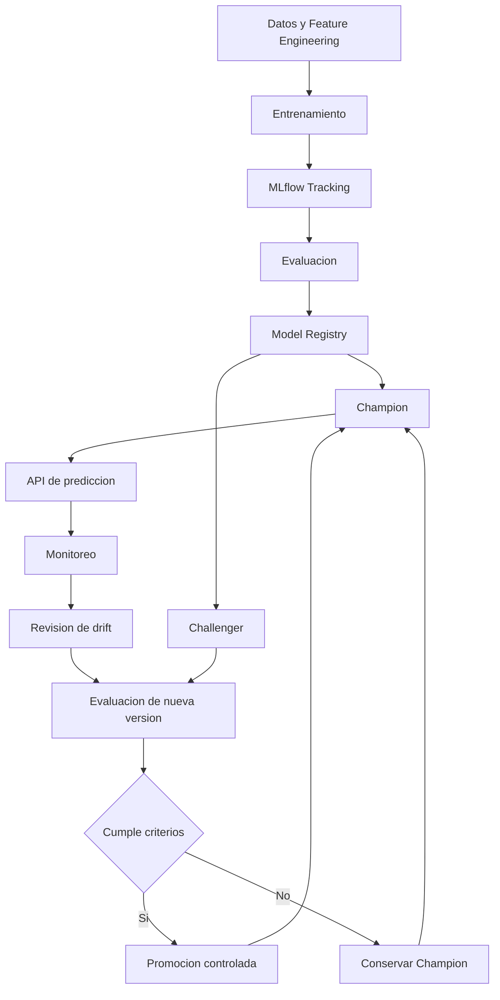

# Validación del Model Registry — Proyecto integrador MiBici

**Equipo:** 45
**Actividad:** Entrega final del proyecto integrador
**Alcance:** Punto 2 — Verificación del Model Registry
**Commit de referencia original:** 2671c33
**Cierre de verificación:** 26 de noviembre de 2026, código base `d4bb784`.

La [revalidación final](revalidacion_20261126.md) incorpora consultas y predicciones nuevas
contra copias locales de los registros reales del equipo. Se conserva la base histórica
sin modificar sus aliases. El registro de referencia contiene los tres champion; el
registro de reproducción A/B contiene las dos versiones de P1. Son registros distintos.

## 1. Objetivo

Verificar la integración del Model Registry de MLflow en el proyecto MiBici, considerando el registro, versionamiento, trazabilidad, selección y recuperación de los modelos de Machine Learning.

La revisión distingue entre las evidencias históricas del repositorio, las recomendaciones derivadas de la evaluación experimental y el estado operativo actual de los modelos.

## 2. Modelos registrados

El proyecto contempla tres problemas de Machine Learning, cada uno asociado con un modelo registrado.

| Pregunta | Modelo registrado | Tipo | Criterio principal |
|---|---|---|---|
| P1 | mibici-p1-demanda | Regresión | Menor val_mae |
| P2 | mibici-p2-riesgo | Clasificación | Mayor val_f1_macro |
| P3 | mibici-p3-grupos | Clustering | Mayor val_ari |

Los criterios de selección se encuentran documentados en la integración de MLflow Tracking y Model Registry.

Para P3, val_ari representa la estabilidad entre agrupaciones de diferentes periodos y no una métrica de exactitud supervisada.

Referencia: [Integración del Registry](../../references/integracion_registry.md).

## 3. Evidencia histórica del Model Registry

La evidencia gráfica del 25 de octubre de 2026 muestra los tres modelos registrados en MLflow 3.16.1.

| Modelo | Versión histórica | Alias histórico |
|---|---|---|
| mibici-p1-demanda | 1 | champion |
| mibici-p2-riesgo | 1 | champion |
| mibici-p3-grupos | 1 | champion |



Esta evidencia confirma que los modelos fueron registrados, versionados y asociados con un alias de producción.

Sin embargo, la captura corresponde a una etapa anterior del proyecto y no permite confirmar por sí sola los aliases vigentes al momento de la entrega final.

## 4. Model Lineage

El linaje permite identificar el origen de un modelo y relacionarlo con los datos, las características, el código fuente y la ejecución de entrenamiento que lo generaron.

### 4.1 Componentes de trazabilidad

| Elemento | Responsabilidad |
|---|---|
| run_id | Identificador de la ejecución de entrenamiento. |
| experiment_id | Identificador del experimento asociado. |
| git_commit | Versión del código fuente. |
| data_version | Identificación de la versión de datos. |
| feature_version | Identificación de las características generadas. |
| run_name | Nombre de la ejecución. |
| Parámetros | Configuración efectiva del entrenamiento. |
| Métricas | Resultados de evaluación. |
| Model Signature | Esquema de entradas y salidas. |
| Model Version | Versión registrada del modelo. |
| Alias | Referencia a una versión seleccionada. |

### 4.2 Evidencia de linaje de P1

La evidencia histórica de P1 permite identificar los siguientes elementos:

| Elemento | Valor observado |
|---|---|
| Run ID | da28d047b8384d089de6f74fcd4e175d |
| Run name | P1_hgb_poisson_estacion_h1 |
| Question | p1 |
| Criterio de selección | val_mae |
| Entradas de la firma | 10 |
| Salidas de la firma | 1 |

También se observan etiquetas asociadas con feature_version y git_commit.



La descripción del modelo establece que la selección se realiza mediante el MAE de validación y que el conjunto de prueba no participa en dicha selección.

Esta separación contribuye a reducir el sesgo en la evaluación.

### 4.3 Evidencias complementarias

El repositorio conserva evidencias adicionales para los tres modelos:

- [Champion histórico de P1](../figures/entrega2/p1_champion.jpg).
- [Champion histórico de P2](../figures/entrega2/p2_champion.jpg).
- [Linaje de P2](../figures/entrega2/p2_linaje.jpg).
- [Champion histórico de P3](../figures/entrega2/p3_champion.jpg).
- [Linaje de P3](../figures/entrega2/p3_linaje.jpg).
- [Artefactos de entrenamiento](../figures/entrega2/artefactos.jpg).
- [Firma del modelo](../figures/entrega2/firma_modelo.jpg).

El linaje de P2 y P3 se comprobó además mediante consulta al registro local de referencia:
run, experimento, commit, versiones de datos y características, parámetros, métricas y firma.
Los resultados completos están en [registry_linaje.json](evidencias_20261126/registry_linaje.json).

## 5. Artefactos y reproducibilidad

La integración de MLflow contempla el registro de:

- Parámetros efectivos de entrenamiento.
- Semillas de reproducibilidad.
- Versiones de datos y características.
- Configuración y dependencias.
- Código fuente asociado.
- Modelos serializados.
- Ejemplos de entrada.
- Predicciones de referencia.
- Métricas de evaluación.
- Figuras y tablas de resultados.

El archivo config/model_check.json conserva ejemplos y resultados de referencia para comprobar que las predicciones se mantienen después de recuperar el modelo.

El registro de estos elementos facilita la auditoría, recuperación y comparación de versiones.

## 6. Champion y Challenger

El alias champion identifica la versión seleccionada para su consumo operativo.

Una versión challenger representa una alternativa que debe evaluarse antes de sustituir al modelo vigente.

El proyecto conserva mecanismos para registrar nuevas versiones, comprobar su recuperación y verificar sus predicciones antes de modificar el alias champion.

La existencia de una versión más reciente no implica automáticamente que esta deba sustituir a la versión vigente.

## 7. Comparación de versiones de P1

El equipo realizó una comparación A/B offline retrospectiva entre dos versiones registradas del modelo de demanda.

### 7.1 Versiones evaluadas

| Elemento | Modelo A | Modelo B |
|---|---|---|
| Modelo registrado | mibici-p1-demanda | mibici-p1-demanda |
| Versión | 1 | 2 |
| Rol en la comparación | Referencia histórica | Challenger |
| Límite de entrenamiento exclusivo | 2026-07-01 | 2026-09-01 |

La evaluación se realizó sobre un conjunto común de 338,690 registros correspondientes a 471 estaciones.

Run ID de la comparación:

`7a429366dfcd415e80e0a167217deebe`

### 7.2 Resultados

| Métrica | Versión 1 | Versión 2 | Resultado favorable |
|---|---:|---:|---|
| MAE | 0.862040 | 0.857719 | Versión 2 |
| RMSE | 1.668304 | 1.611107 | Versión 2 |
| WAPE | 59.7064 % | 59.4071 % | Versión 2 |
| R² | 0.642540 | 0.666630 | Versión 2 |

La reducción relativa del MAE fue aproximadamente del 0.50 %.

La reducción relativa del RMSE fue aproximadamente del 3.43 %.

### 7.3 Evaluación por segmento

| Segmento | Registros | Estaciones | MAE A | MAE B |
|---|---:|---:|---:|---:|
| Estaciones conocidas | 297,360 | 413 | 0.916137 | 0.911665 |
| Estaciones nuevas | 41,330 | 58 | 0.472829 | 0.469591 |

La versión alternativa presenta una reducción del MAE en ambos segmentos.

### 7.4 Evidencia estadística

La comparación documenta una mejora absoluta del MAE de 0.004321, con un intervalo de confianza del 95 %:

[0.002236, 0.006238]

El intervalo se obtuvo mediante bootstrap pareado circular, utilizando bloques de siete días, 5,000 réplicas y semilla 42.

Los criterios establecidos para recomendar una nueva versión fueron:

- Reducción del MAE.
- Intervalo de confianza favorable.
- Ausencia de deterioro en RMSE.
- Ausencia de deterioro en estaciones nuevas.

La versión 2 cumple los cuatro criterios documentados.



Referencia: [Resultados del A/B testing](../abtest/resultados.md).

### 7.5 Interpretación y limitaciones

Los resultados respaldan la recomendación de considerar la versión 2 como candidata a producción.

Sin embargo:

- La comparación fue offline y retrospectiva.
- No se realizó una asignación aleatoria de tráfico real.
- Septiembre ya había sido observado en actividades anteriores, aunque ninguna versión utilizó sus registros para ajustar los pesos.
- Los resultados no garantizan el mismo desempeño en periodos futuros.
- El procedimiento de comparación no modifica los aliases del Registry.

Por lo tanto, la recomendación de la versión 2 no constituye evidencia de que haya sido promovida efectivamente como champion.

## 8. Recuperación de modelos registrados

El proyecto incorpora mecanismos para recuperar modelos mediante su nombre y alias.

Ejemplo de URI:

`models:/mibici-p1-demanda@champion`

El código permite utilizar un servidor externo de MLflow mediante la variable de entorno MLFLOW_TRACKING_URI.

Los principales componentes son:

| Archivo | Responsabilidad |
|---|---|
| mibici/train.py | Entrenamiento y registro de modelos. |
| mibici/tracking.py | Trazabilidad y comprobación de recuperación. |
| mibici/predict.py | Carga y generación de predicciones. |
| mibici/model_loader.py | Recuperación desde MLflow configurado externamente. |
| mibici/verify_registry.py | Verificación de versiones y predicciones. |

Referencias:

- [Model Loader](../../mibici/model_loader.py).
- [Predicción](../../mibici/predict.py).
- [Verificación del Registry](../../mibici/verify_registry.py).
- [Tracking](../../mibici/tracking.py).

## 9. Procedimiento de verificación funcional

### 9.1 Configuración del entorno

Desde la raíz del repositorio, utilizar un entorno Python con las dependencias del proyecto instaladas.

Configurar MLFLOW_TRACKING_URI con la dirección del servidor que contiene los modelos y artefactos registrados por el equipo.

Ejemplo para PowerShell, suponiendo que el servidor correspondiente está disponible localmente:

```powershell
$env:MLFLOW_TRACKING_URI="http://127.0.0.1:5000"
```

La dirección anterior es un ejemplo y debe sustituirse si el servidor real utiliza otra dirección.

Iniciar un servidor vacío no permite recuperar automáticamente los modelos históricos.

### 9.2 Smoke test del Registry

```bash
python -m mibici.verify_registry --question all --smoke-only
```

La comprobación rápida permite recuperar los modelos asociados con el alias champion y verificar las predicciones mediante los ejemplos de referencia.

Para guardar evidencia:

```bash
python -m mibici.verify_registry --question all --smoke-only --output reports/final/registry_smoke_test.json
```

### 9.3 Verificación completa

```bash
python -m mibici.verify_registry --question all
```

La comprobación completa incluye:

- Recuperación del modelo.
- Consulta de la ejecución de origen.
- Comparación de data_version.
- Comparación de feature_version.
- Generación de predicciones sobre validación.
- Comparación de métricas con las registradas originalmente.

También puede ejecutarse mediante MLflow Projects:

```bash
mlflow run . -e verify
```

La verificación completa requiere que los datos y las características locales correspondan con las versiones utilizadas por el modelo registrado.

Una discrepancia de versiones debe investigarse antes de considerar reproducidos los resultados.

### 9.4 Consulta de una versión alternativa

Si existe el alias challenger en el Registry, puede verificarse mediante:

```bash
python -m mibici.verify_registry --question P1 --alias challenger --smoke-only
```

Los procedimientos anteriores no requieren reentrenar los modelos ni promover nuevas versiones.

### 9.5 Estado de ejecución

El 26 de noviembre se recuperaron los champion reales de P1, P2 y P3 con el código actual.
Los tres reprodujeron cinco predicciones de referencia por modelo con tolerancia `1e-12`.
Se comprobó también el challenger de P1 en el registro separado de la reproducción A/B.

La evaluación completa utilizó el código de origen `92e305f`, el catálogo histórico y
las tablas cuyos SHA-256 coinciden con sus manifiestos. Reprodujo las métricas de
validación: P1 MAE `0.7497917145254663`, P2 F1 macro `0.882361022824495` y las métricas
de asignación de P3 sobre 468 estaciones. El detalle está en
[registry_validacion_historica.json](evidencias_20261126/registry_validacion_historica.json).

La configuración de ingesta actual difiere de la histórica. El verificador completo
de `main` rechaza correctamente esas tablas antiguas por su hash de configuración.
Para reproducir las métricas se utiliza el código de origen; para una ejecución nueva
se regeneran datos y variables y se obtiene otra versión. No se omite ese control.
La [revalidación final](revalidacion_20261126.md) documenta ambas rutas y la ejecución
del MLflow Project con datos nuevos. Estas comprobaciones son locales y no acreditan
el estado de un servidor privado de otro integrante.

## 10. Criterios de promoción a producción

Se recomienda aplicar el siguiente procedimiento:

1. Entrenar y registrar una versión alternativa.
2. Conservar el linaje y los artefactos del entrenamiento.
3. Evaluar ambas versiones sobre un periodo común.
4. Comprobar las métricas principales y los segmentos relevantes.
5. Verificar la recuperación del modelo.
6. Revisar la calidad y vigencia de los datos.
7. Autorizar la promoción de manera controlada.
8. Actualizar el alias champion cuando corresponda.
9. Conservar la versión anterior para una posible reversión.
10. Monitorear el desempeño después del cambio.

La detección de drift debe iniciar una revisión técnica, pero no debe provocar automáticamente la sustitución del modelo vigente.

## 11. Integración con el ciclo de vida de MLOps



El Model Registry constituye el punto de conexión entre la experimentación y la operación del modelo.

Su integración permite recuperar versiones específicas y administrar el ciclo de mejora continua sin modificar directamente la lógica de consumo de la API.

El diagrama representa el flujo recomendado de operación y no implica que exista un mecanismo automático de Continuous Training.

## 12. Matriz de cumplimiento

| Requerimiento | Evidencia | Estado |
|---|---|---|
| Registro de P1, P2 y P3 | Consulta al registro local real y recuperación | Comprobado |
| Versionamiento | Registro de referencia y registro separado de A/B | Comprobado |
| Alias champion | v1 de P1/P2/P3 en el registro de referencia | Comprobado |
| Linaje de P1 | Run ID, tags, métricas y firma | Comprobado |
| Linaje de P2 y P3 | Consulta de las versiones y runs reales | Comprobado |
| Criterios de selección | Documentación de integración | Revisado |
| Comparación de versiones P1 | A/B testing offline | Revisado |
| Recomendación de nueva versión | Versión 2 de P1 | Justificada |
| Recuperación por alias | Código de recuperación | Implementado |
| Verificación de predicciones | verify_registry.py | Implementado |
| Estado de los aliases del registro local de referencia | registry_linaje.json | Comprobado |
| Smoke test de los tres champion y el challenger | JSON de ejecución del 26 de noviembre | Comprobado |
| Reproducción de métricas | Datos, tablas y código histórico compatibles | Comprobado |

## 13. Conclusión

El proyecto MiBici integra mecanismos de registro, versionamiento, trazabilidad y recuperación de modelos mediante MLflow Model Registry.

Las evidencias históricas demuestran el registro de los modelos P1, P2 y P3, así como la asignación del alias champion en una etapa previa del proyecto.

La comparación offline de P1 proporciona evidencia favorable para considerar la versión 2 como candidata a producción, con mejoras en las métricas evaluadas y en los segmentos de estaciones conocidas y nuevas.

La decisión de entrega conserva v1 en la API y mantiene v2 como candidata. La comparación
offline no mueve aliases y no acredita desempeño futuro. La promoción se condiciona a
una evaluación en otro periodo y revisión técnica, conservando la versión anterior.

Las consultas, predicciones y métricas del registro local real complementan la revisión
documental. El alias `champion` define el modelo consumido por el prototipo local; no se
declara un servicio público en producción. La importación de P1/P2 a Compose conserva
la procedencia y vuelve a comprobar las predicciones antes de habilitar la API.
